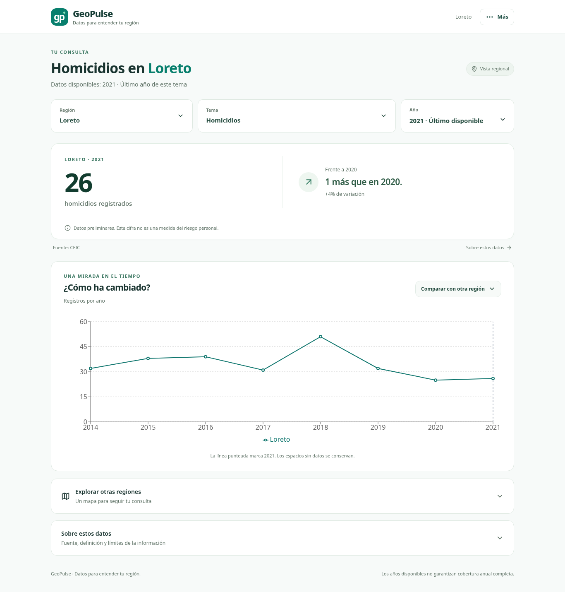
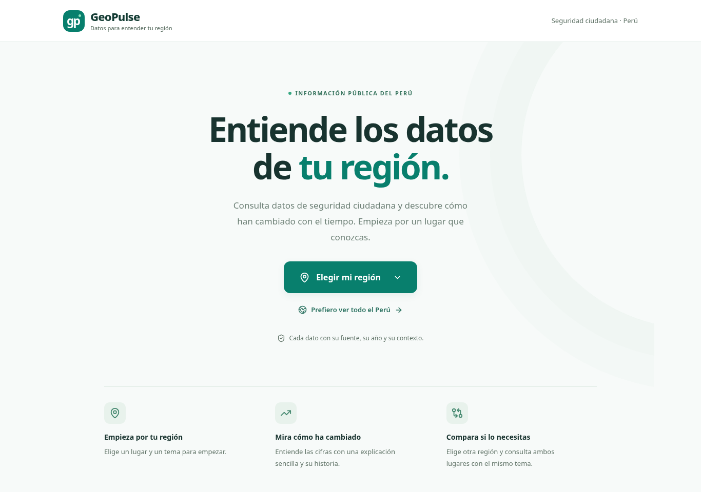
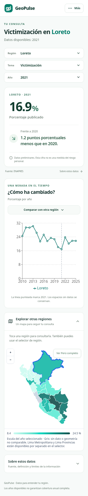

# GeoPulse

**Entiende los datos de seguridad ciudadana de tu región.**

GeoPulse permite consultar cifras del Perú, descubrir cómo han cambiado y comparar regiones con explicaciones en lenguaje sencillo. Cada resultado conserva su fuente, año y unidad.

**Next.js · React · TypeScript · FastAPI · Pandas · Leaflet · Recharts**

[Ejecutar localmente](#ejecución-local) · [Arquitectura](#arquitectura-y-decisiones) · [Pruebas](#verificación)

<p align="center">
  <a href="assets/region-desktop.png">
    
  </a>
</p>

*Una consulta regional: la cifra principal, su cambio respecto al año anterior y su historia en una misma pantalla.*

## Qué puedes hacer

- Elegir región, tema y año mediante controles visibles y buscadores con nombres breves.
- Entender recuentos con diferencias absolutas y porcentajes con cambios en puntos porcentuales.
- Explorar un mapa completo del Perú cuando quieras consultar otro territorio.
- Consultar el dato nacional original y la historia de un territorio.
- Comparar dos regiones y destacar el año seleccionado.
- Compartir filtros mediante la URL y exportar CSV con fuente, unidad y estado preliminar.
- Consultar fuente y metodología en «Sobre estos datos», y herramientas experimentales desde «Más».

<details>
<summary><strong>Ver el inicio y la experiencia móvil</strong></summary>

### Empieza por tu región

La bienvenida ofrece una primera acción: elegir una región. También permite consultar el panorama nacional de forma explícita.

<p align="center">
  <a href="assets/welcome-desktop.png">
    
  </a>
</p>

### Consulta desde el móvil

Los controles permanecen visibles y el mapa se despliega cuando se necesita explorar otros lugares.

<p align="center">
  <a href="assets/region-390.png">
    
  </a>
</p>

</details>

## Interpretación de los datos

El catálogo se transcribió del diccionario local `DICCIONAR_DAT_ Ind_ Plan_Acc_Seg_Ciud_Nov 2025 (1).xlsx`. Se conserva `VALORES`, la columna preliminar, sin reemplazarla por `VALORES_2` ni mezclar ambas. En los indicadores de denuncias y homicidios esta columna contiene recuentos aunque el nombre oficial describa una tasa. El dashboard muestra el nombre oficial, la medida utilizada y su unidad por separado.

No se suman indicadores, porcentajes, tasas ni años. El dato nacional procede exclusivamente de la observación de ámbito nacional; si falta, se muestra «Sin dato nacional». Cero y ausencia de datos son distintos. Las variaciones requieren dos años consecutivos y un denominador positivo.

Lima Metropolitana (`1501`) y Lima Provincias (`1599`) son territorios distintos. El GeoJSON departamental tiene un único polígono para Lima: queda gris, y ambos territorios se consultan mediante el selector y la comparación. El mapa permite seleccionar el resto de regiones; el selector ofrece la alternativa accesible por teclado.

**Cobertura:** el nombre del archivo no acredita que todos los indicadores lleguen a 2026 ni que un año esté completo. Por ejemplo, en el archivo local revisado la serie de homicidios termina en 2021. Los periodos se obtienen de las observaciones de cada indicador.

**ML:** el módulo de XGBoost clasifica observaciones históricas; no demuestra capacidad de pronóstico. Su evaluación temporal, las filtraciones y la calibración siguen pendientes. Las puntuaciones no equivalen a certeza de riesgo. Se conserva el pipeline de investigación sin reentrenarlo en esta entrega.

## Ejecución local

Requisitos: Python 3.13+, `uv`, Node.js 24 y `pnpm`. PostGIS no es necesario para esta versión: la API consulta CSV en memoria. El Compose existente se conserva para investigación futura, sin integración activa con el dashboard.

### Backend

```bash
cd api
uv sync --locked
uv run uvicorn main:app --reload --port 8000
```

Por defecto se utiliza `api/data/`, que debe contener exactamente un `DATASET_Ind*.csv`. Si existe `peru_departamento_.json` en ese directorio se utilizará; de lo contrario se usa el GeoJSON versionado en `client/public/`. Consulta [api/README.md](api/README.md) para el contrato y la configuración.

Para probar la aplicación sin descargar datos oficiales, usa la muestra **sintética**, que no representa estadísticas reales:

```bash
cd api
GEOPULSE_DATA_DIR=sample_data uv run uvicorn main:app --port 8000
```

La muestra declara `DEMO_SINTETICO` como fuente. No contiene artefactos de ML: esa vista informa que no están disponibles.

### Frontend, en otra terminal

```bash
cd client
pnpm install --frozen-lockfile
pnpm dev
```

Abre `http://localhost:3000`. La API usa `http://localhost:8000` por defecto. Copia `client/.env.example` a `client/.env.local` si necesitas otra URL.

## Arquitectura y decisiones

```text
CSV + catálogo oficial → FastAPI/Pandas → consultas por indicador → Next.js/React
                                       ↘ CSV con metadatos
Artefacto XGBoost histórico → endpoint experimental separado
```

- `api/`: validación al cargar, catálogo versionado, observaciones nacionales/regionales y exportación.
- `client/`: filtros en URL, solicitudes cancelables, mapas Leaflet y series Recharts.
- `ml_research/`: experimentos existentes; no se ejecutan para servir el dashboard.
- `data/`: fuentes locales de investigación, excluidas del repositorio.

Los duplicados de indicador/territorio/año y los códigos no catalogados hacen fallar la carga, en lugar de sumarse silenciosamente. El servicio responde 503 si no pudo cargar los datos; `/health` expone ese estado. Las consultas inválidas devuelven 422. La antigua distribución entre indicadores devuelve 410 porque mezclaba medidas incompatibles.

## Verificación

```bash
cd api
uv run python -m unittest discover -s tests -v
```

```bash
cd client
pnpm test
pnpm lint
pnpm build
```

GitHub Actions ejecuta las mismas comprobaciones con datos sintéticos. Las pruebas cubren contratos de API, filtros, unidades, dato nacional, Lima, variaciones consecutivas, ceros, ausencias y exportación.

## Trabajo posterior

Validación temporal de ML sin filtraciones, documentación de resultados contra baselines, despliegue público y reportes PDF/Excel. No hay autenticación, alertas en tiempo real ni conexión activa con PostGIS.

Licencia MIT: [LICENSE](LICENSE).
